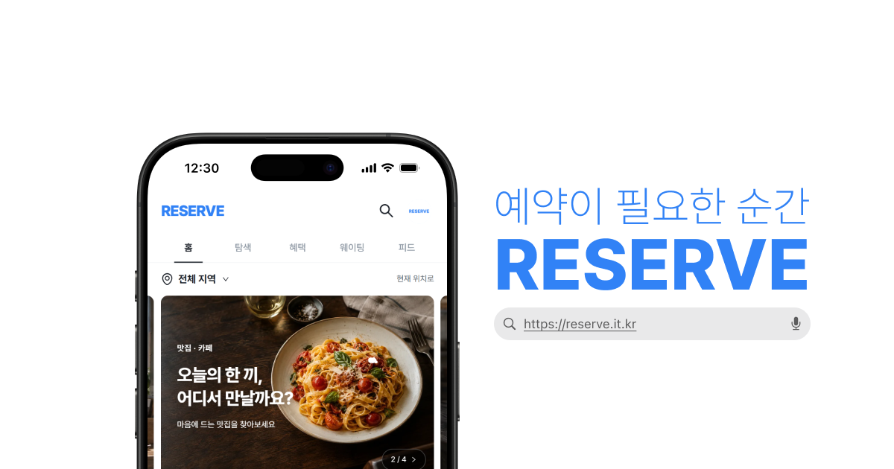
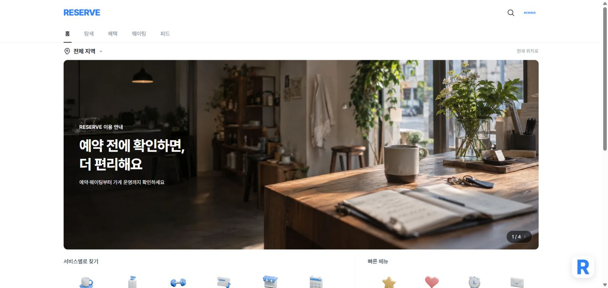
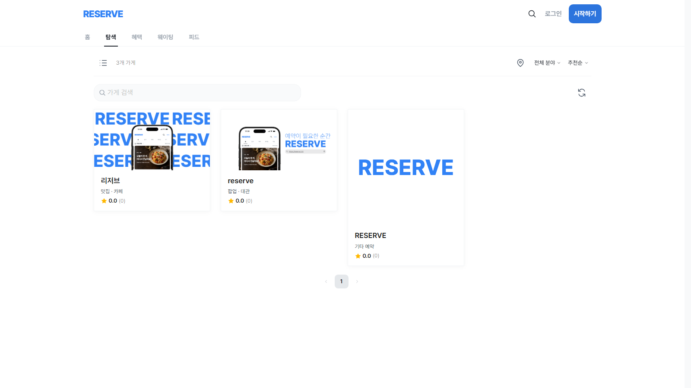
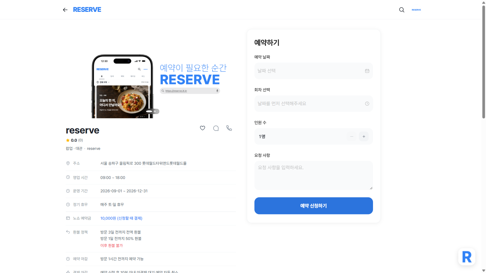
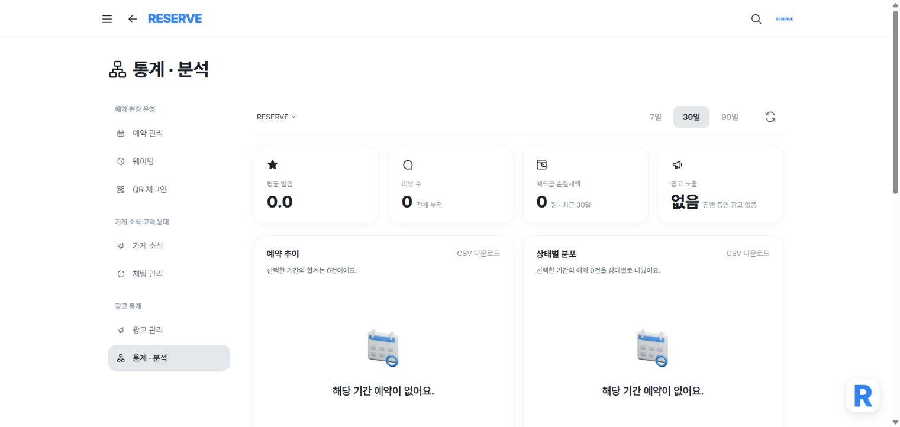
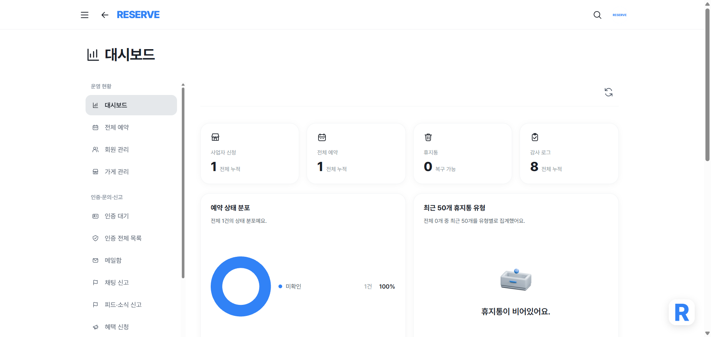
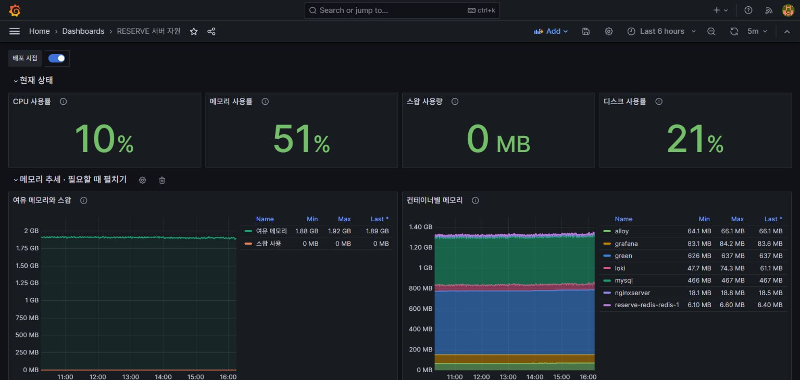

[**서비스 바로가기**](https://reserve.it.kr)

 

 

## 소개

RESERVE는 가게 탐색부터 예약·웨이팅·결제·문의까지 제공하는 예약 플랫폼이에요.

## 화면

예약 서비스([app.reserve.it.kr](https://app.reserve.it.kr))의 화면 예시예요.

| 홈 | 가게 목록 |
|---|---|
|  |  |

| 가게 상세 | 사업자 패널 |
|---|---|
|  |  |

| 관리자 패널 | 모니터링 |
|---|---|
|  |  |

## 주요 기능

| 영역 | 기능 |
|---|---|
| 탐색 | 분야·지역 검색, 정렬, 즐겨찾기 |
| 예약·웨이팅 | 시간대·회차·날짜 예약, 빈자리·정원 확인, 현장 대기 |
| 결제 | 예약금 결제, 취소·환불 |
| 방문 | QR 체크인, 완료·노쇼 처리 |
| 메시지 | 고객지원·가게 문의, 사진·차단·신고 |
| 가게 운영 | 운영 일정·예약 정책·광고·통계 |
| 관리 | 인증 심사·계정 관리·감사 기록 |

## 기술 스택

| 영역 | 기술 |
|---|---|
| **Backend** | Spring Boot 4.1.2 · Java 21 · Spring Security · JWT · OAuth2 |
| **Frontend** | React 19 · Vite · Ant Design 6 · TanStack Query 5 · Zustand · Recharts |
| **Database** | MySQL 8.0 · Redis 8.2 |
| **Infra** | AWS Lightsail · Docker · Nginx · GitHub Actions · S3 + CloudFront |
| **결제 · 메일** | 포트원 V2 · Resend |
| **모니터링** | Grafana · Loki · Alloy · Sentry · UptimeRobot |
| **품질** | JUnit · Vitest · Playwright · ESLint · CodeQL · SonarCloud(수동 정적 분석) |

## 아키텍처

  

## 문서

| 분류 | 문서 |
|---|---|
| **사용 안내** | [손님 가이드](docs/guide/user-guide.md) · [사장님 가이드](docs/guide/owner-guide.md) · [업데이트 소식](docs/CHANGELOG.md) |
| **기술 · 운영** | [기술 문서](docs/technical/README.md) |
| **정책** | [보안 정책](SECURITY.md) · [서드파티 고지](THIRD_PARTY_NOTICES.md) |
