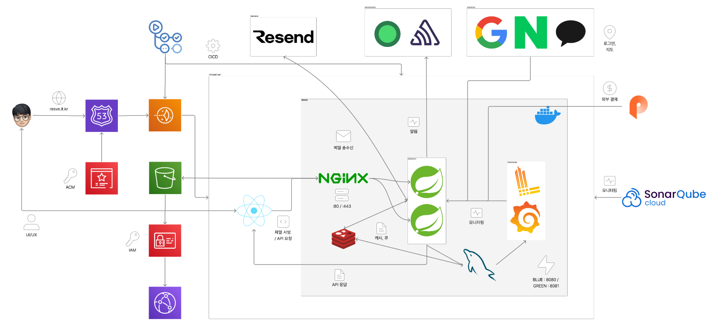

# 아키텍처

## 서비스 구성

- reserve.it.kr는 서비스 소개, app.reserve.it.kr는 예약·계정·관리 화면을 제공해요.
- Nginx가 HTTPS 연결을 받고 화면 파일과 API 요청을 나눠 전달해요.
- API 서버는 예약·결제·회원 권한을 확인하고 데이터를 처리해요.

## 데이터 저장

| 구성 | 역할 |
|---|---|
| MySQL | 회원·가게·예약·결제·메시지의 원본 데이터 |
| Redis | 여러 서버가 함께 쓰는 요청 제한·변경 알림 중계와 선택적 예약 입장 대기 |
| S3 | 사진·첨부파일 저장 |
| CloudFront | 공개 이미지의 빠른 전송 |

Redis 알림은 원본 데이터를 대신하지 않아요. 브라우저는 서버가 보내는 갱신 알림(SSE)을 받으면 API에서 최신 데이터를 다시 읽어요.

프로필·가게 사진은 공개 이미지예요. 사업자 서류와 채팅·피드 첨부파일은 권한을 확인한 뒤 제공해요.

메신저 검색은 대화 상대·메시지·공개 가게를 구분해요. 개인 검색은 현재 회원·역할·대화 소유권을 매번 확인하고 숨김·차단·회수·보유기간을 적용해요. 관리자의 전체 대화 조회는 고객지원으로 한정해요. 검색어는 URL에 넣지 않고 읽기 전용 `POST /api/chat/search`로 전달하며 결과는 세션 메모리에서만 사용해요.

검색한 메시지는 권한을 다시 확인해 이전 대화 위치로 열어요. 이때 새 대화 생성·읽음 처리를 하지 않으며 최신 대화로 이동하면 기존 읽음·답장 흐름을 사용해요.

## 로그인 세션

브라우저는 액세스·리프레시 정보를 HttpOnly 쿠키로 전송해요. 리프레시 쿠키는 두 인증 경로(`/api/auth`, `/api/v1/auth`)로 제한해요. 서명·issuer·audience·용도·기한을 검증하고 현재 회원 상태와 기기별 `login_session`을 확인해요.

DB에는 리프레시 토큰 원문 대신 해시와 재구성에 필요한 비밀이 아닌 메타데이터를 저장해요. 갱신할 때 토큰을 회전하고, 직전 세대는 60초 동안 같은 결과를 복구해요. 더 오래된 세대의 재사용은 해당 기기의 세션을 회수해요. 기본 유지 기간은 마지막 갱신부터 14일이며 최초 로그인부터 30일을 넘지 않아요. 동시 로그인도 회원 잠금 안에서 최대 다섯 기기로 제한해요.

로그아웃한 기기는 다음 인증 요청부터 거부해요. 이미 열린 SSE는 다음 전송 또는 15초 heartbeat에서 세션을 다시 확인해 종료해요. 선택적 `kid`·키 목록을 지원하지만 실제 서명 키 변경은 별도 운영 절차로 진행해요.

인기 예약의 입장 허용은 예약 확정과 달라요. 인기 예약 입장 대기는 Redis에서 순번을 관리하고 MySQL의 정원 검사와 요청별 예약 결과를 정본으로 사용해요.

## 배포

GitHub Actions가 검사와 빌드를 수행해요. Lightsail의 Blue/Green 컨테이너 중 새 버전을 준비한 뒤, Nginx가 화면과 API를 함께 전환해요. 전환에 실패하면 호환성을 확인한 이전 버전으로 돌아가요.

## 외부 서비스

| 서비스 | 용도 |
|---|---|
| AWS Lightsail·Route 53 | 서버와 도메인 |
| S3·CloudFront | 파일 저장과 이미지 전송 |
| PortOne | 예약금·광고 결제 |
| Resend | 이메일 발송 |
| Google·Kakao·Naver | 소셜 로그인 |
| Grafana·Loki·Alloy·Sentry | 서버 상태와 오류 관측 |

### 지원 메일

문의 작성·관리자 새 메일·문의 답변의 미리보기는 발송과 같은 서버 HTML 템플릿을 사용해요. 미리보기 버튼을 누를 때만 렌더링하며 문의·사진·발송 기록을 저장하거나 메일을 보내지 않아요. 첨부 사진은 브라우저에서 확인하고 최종 전송 때 업로드해요. 공개 문의 미리보기는 IP별, 관리자 미리보기는 회원별 분당 20회로 제한하며 발송 한도와 분리해요. 미리보기 HTML은 스크립트·외부 요청을 차단한 iframe 안에서 표시해요. 실제 메일 앱의 폰트 지원과 화면 폭에 따라 표시가 달라질 수 있어요.

Resend의 이메일 수신을 연결한 뒤 **email.received**를 앱의 **POST /api/inquiries/inbound/resend**로 전달해요. 앱은 원본 본문의 Svix 서명과 수신 주소를 확인하고 Resend API에서 본문을 읽어요. 동일한 수신 식별자는 문의 한 건으로 저장해요. 본문은 텍스트로 표시해요. JPG·PNG·WebP 사진은 한 장당 2MB, 최대 3장까지 실제 형식을 확인해 문의와 함께 저장해요. 관리자 메일함에서 첨부를 확대할 수 있고, 답변과 새 메일의 사진은 MIME 첨부로 발송해요. 원본 Message-ID가 있으면 답변은 같은 메일 스레드로 이어져요. [수신 웹훅](https://resend.com/docs/dashboard/receiving/create-receiving-webhook)

[수신 메일 DDL](../../backend/src/main/resources/db/manual/inquiry-inbound-email.sql)과 [첨부 사진 DDL](../../backend/src/main/resources/db/manual/support-mail-photos.sql)을 적용한 뒤 앱을 시작해요. 문의와 발송 사진은 비공개 테이블에 저장하고 조회마다 관리자 권한과 휴지통 상태를 확인해요. 문의나 발송 기록이 영구 삭제되면 사진도 삭제돼요. 수신 기능은 기본 비활성이며, **RESEND_INBOUND_ENABLED**를 켤 때 **RESEND_INBOUND_ADDRESS**, **RESEND_INBOUND_WEBHOOK_SECRET**, 수신 메일 조회 권한이 있는 **RESEND_INBOUND_API_KEY**를 설정해요. 기존 지원 주소의 MX나 전달 설정은 해당 주소의 다른 메일 흐름과 함께 확인해요.

받은 문의와 보낸 메일은 관리자 휴지통에서 30일간 복구할 수 있어요. 받은 문의가 휴지통에 있는 동안 조회·회신 목록에서 숨겨지며 같은 수신 이벤트가 다시 와도 새 문의로 등록하지 않아요.
