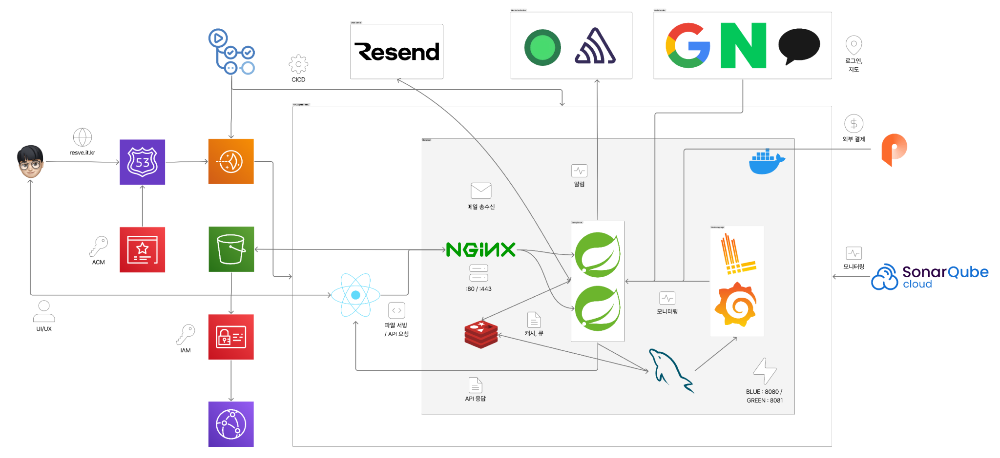

# 아키텍처

RESERVE의 인프라 구성, 저장소 경로, 배포 흐름을 정리했어요.


## 2026-10-18 운영 구성

v2.12.0 main `b150ba5ac53fb2e2aaee1fc1f3866106615f5fbc`를 앱 `https://app.reserve.it.kr`와 소개 `https://reserve.it.kr`로 전환했어요. MySQL 8.0.45는 정본, 별도 Redis는 공유 제한·서버 이벤트 중계, SSE는 브라우저 전달을 담당해요. 운영 Redis는 `reserve-redis-redis-1`에서 인증·데이터 64MB·컨테이너 128MiB·호스트 포트 없음으로 동작하며 local과 production namespace를 구분해요. 공개 프로필 두 경로의 CloudFront 캐시는 TTL 0이고 그 밖의 기본 캐시 동작은 유지해요. 이하 준비 단계의 상태는 [실제 전환 기록](deployments.md#2026-10-18-v2120-실제-운영-전환)과 날짜를 함께 확인해요.

## 인프라 구성



## AWS 서비스

| 서비스 | 용도 | 세부 |
|---|---|---|
| **Lightsail** | 애플리케이션 서버 | `small_3_0` — 2 vCPU · 2GB RAM · 60GB SSD, 서울(ap-northeast-2) |
| **Route 53** | DNS 호스팅 | reserve.it.kr 호스팅 영역 |
| **S3** | 이미지 스토리지 | reserve-it-kr-bucket, 서울 |
| **S3** | DB 백업 | reserve-it-kr-backup, 서울 — 비공개·기본 암호화·버전 관리, 현재 버전 14일·이전 버전 7일 |
| **CloudFront** | 이미지 CDN | cdn.reserve.it.kr |
| **ACM** | SSL 인증서 | CloudFront용, us-east-1 리전 |
| **IAM** | S3 접근 제어 | `reserve-s3-user`: 이미지 버킷 올리기·보기·지우기 · `reserve-backup-uploader`: 백업 버킷 `mysql/` 올리기 |
| **Budgets** | 요금 알림 | 월 예산 초과(실제 80%·예상 100%) 시 메일 |

채팅 사진도 이미지 버킷과 같은 권한을 써요.

## S3 폴더 구조

사용자 파일은 `users/{memberId}/`, 공지 파일은 `notices/`, 고객지원 사진은 `system/chat/support/` 아래예요.
대화 사진은 `users/{senderId}/chat/{roomId}/*.bin` 암호문이라 CDN으로 공개하지 않아요.
모든 경로는 `file/util/FileStoragePaths.java`와 환경 prefix를 따라요.

채팅의 메시지 JSON은 최신 50개·과거 커서 단위로 주소와 사진 치수만 내려주고 S3 사진 본문은 읽지 않아요. `ChatImage`가 실제 대화 스크롤 영역의 위아래 240px 안에 온 사진부터 두 개씩 no-store API로 읽으며, 서버가 매번 참여·숨김·취소 권한을 확인한 뒤 해당 암호문 하나를 읽고 복호화해요.

피드·댓글은 `LoadingAntImage`의 lazy 경로가 실제 화면 근처까지 src/srcSet/fallback을 보류해 AntD의 별도 유효성 확인 요청도 먼저 나가지 않게 해요. 가로 사진 띠의 잘림과 숨긴 탭도 확인하고 원래 확대 목록은 유지해요. 활성화된 뒤 라이브러리의 검증/표시 요청을 합쳐 HTTP 요청 한 번만 발생한다고 보장하는 구조는 아니에요. 혜택 목록과 가게 카드/행은 native lazy, 공통 상세 `PhotoGallery`는 현재 슬라이드부터 ondemand를 사용해요. 기존 즉시 로딩의 사업자 서류·갤러리와 원래 크기·스와이프·확대 동작은 유지해요.

페이지네이션·lazy만으로 서버의 모든 조회를 최적화했다고 해석하지 않아요. 피드/댓글 DTO의 항목별 사진·좋아요·답글 조회는 묶음 조회 후속이며 실제 SQL 횟수를 이번에 계측하지 않았어요.

가게·프로필 사진의 CloudFront URL은 공개 주소예요. 2026-10-12에 사용자가 제시한 프로필 이미지의 익명 HEAD가 200이고 `public, max-age=86400` 캐시임을 확인했어요. 주소를 알면 로그인 없이 볼 수 있으므로 계정 사진을 비공개 사진으로 설명하지 않아요. 별도 피드 프로필 사진도 같은 공개 사진 저장 관문을 사용하며 경로는 `users/{memberId}/feed/profiles`예요. 사업자 인증 서류는 권한 확인 후 5분 pre-signed URL, 채팅 사진은 회원 권한·개인 숨김을 검사하는 no-store API, 피드 본문·댓글 사진은 글의 공개 상태/권한을 확인하는 암호문 저장·API 읽기로 구분해요. 이 공개 사진 조회만으로 운영 S3/CloudFront의 모든 접근 설정을 재검증했다고 확대하지 않아요.

```
reserve-it-kr-bucket/
└── users/{memberId}/
    ├── profiles/                              ← 프로필 이미지
    ├── businesses/                            ← 사업자 인증 서류 (pre-signed URL로만 조회)
    └── stores/{storeId}/
        ├── thumbnails/                        ← 가게 대표 이미지
        ├── images/                            ← 가게 상세 이미지
        └── advertisements/                    ← 광고 배너 이미지
```

로컬 개발 환경은 경로 앞에 `local/`이 붙어요(예: `local/users/1/profiles/xxx.jpg`).

### 이미지 업로드 검사

모든 S3 업로드는 `ImageFileValidator`가 실제 바이트 형식, 선언 MIME, 확장자, 크기, 해상도를 대조해요.

| 항목 | 규칙 |
|---|---|
| 허용 형식 | JPEG, PNG, GIF, WebP |
| 크기 | 파일당 최대 8MB, 가게·광고 한 요청의 새 이미지 합계도 8MB |
| 해상도 | 한 변 최대 8192px, 전체 최대 2천만 픽셀 |

- JPEG/PNG/GIF는 ImageIO로 전체 디코딩해요.
- WebP는 RIFF chunk 경계, 캔버스 헤더, 실제 VP8/VP8L 프레임(애니메이션은 ANMF 내부 프레임)을 검사해요.
- S3 key와 metadata는 서버가 정한 MIME과 확장자로 만들어요.
- 프론트의 형식·크기 검사는 입력 편의용이고, 최종 판단은 서버가 해요.

## Docker 컨테이너

```
app-network (bridge)
  ├── nginxserver  → 80, 443
  ├── blue         → 8080:8080 (또는 비활성)
  ├── green        → 8081:8081 (또는 비활성)
  └── mysql        → 127.0.0.1:3306:3306
```

### Nginx 마운트

```
/home/ubuntu/nginx          → /etc/nginx/conf.d
/usr/share/nginx/html       → /usr/share/nginx/html (React SPA release root)
  ├── current              → releases/<commit-sha> (운영 도구용 현재 포인터)
  └── releases/            → 현재 + 직전 2개 프론트 빌드
/etc/letsencrypt            → /etc/letsencrypt:ro (SSL 인증서)
```

Nginx `root`는 전환 때 고른 `releases/<commit-sha>` 절대 경로예요. 전환 절차는 [배포 운영](deployments.md)을 봐요.

## 데이터 저장 위치

| 데이터/일 | 저장 위치 |
|---|---|
| 가게 폼 초안 | 브라우저 IndexedDB, 최종 제출만 서버로 → [가게 임시저장](store-drafts.md) |
| 거래·회원·예약 | 단일 MySQL |
| 이미지 | S3 + CloudFront |
| 외부 작업 재시도 | MySQL outbox + scheduler → [계정 보안](account-security.md) |
| 로그·자원 지표 | collect-metrics.sh / Alloy / Loki / Grafana |
| 배포 | Lightsail Blue/Green, JVM heap 상한 512MB |

## 백업

- 비공개 S3 버킷에 올리기 전용 계정으로 올려요. 버전 관리·현재 버전 14일/이전 버전 7일과 최신 복구 입력의 별도 보존은 [백업 런북](backup.md)을 따라요.
- 서버 스크립트가 매일 03:10 KST cron으로 돌아요.
- 절차는 [백업·복구 런북](backup.md)을 따라요.

## Blue/Green 배포 흐름

```
1. main 브랜치 push

2. GitHub Actions 시작
   ├── test-backend / test-frontend
   │     └── 백엔드 unit·H2, 프론트 lint·단위·브라우저 테스트
   ├── build-frontend (needs: test-frontend)
   │     └── npm build → dist 아티팩트
   ├── build-backend (needs: test-backend, build-frontend)
   │     └── 프론트 HTML 포함 Gradle 빌드 → Docker 이미지 → DockerHub push
   ├── stage-release (needs: build-backend, build-frontend)
   │     └── SCP → releases/<SHA>와 SHA별 Nginx 템플릿 staging (live 변경 없음)
   └── deploy-backend (needs: 위 전부)
         ├── 현재 활성 컨테이너 확인 (Blue or Green)
         ├── 반대 컨테이너 새로 기동
         ├── SSH 내부 헬스체크 (localhost:port/actuator/health)
         ├── 새 프론트 절대 root + 새 upstream 후보를 함께 검사
         ├── 한 번의 Nginx reload로 전환
         ├── Nginx 경유 HTML·asset·공개 API smoke
         └── 성공 뒤 구 컨테이너 종료; 실패 시 root·upstream 함께 rollback
```

## Git 브랜치

```
main          ← 배포 브랜치 (CI/CD 트리거)
  ↑
dev           ← 개발 통합 브랜치 (기본 브랜치)
  ↑
feature/*     ← 기능별 작업
```

- `feature/*` 완료 → `dev` PR 머지 (배포 없음)
- `dev` → `main` PR 머지 → CI/CD 자동 실행
- 긴급 수정: `hotfix/*` → `main` 직접 PR

자세한 규칙은 [Git 워크플로우](../rules/git-workflow.md)를 봐요.

## SSL 인증서

| 항목 | 값 |
|---|---|
| 방식 | Let's Encrypt (Certbot **HTTP-01 webroot**) |
| 위치 | `/etc/letsencrypt/live/reserve.it.kr/` (root·www), `/etc/letsencrypt/live/grafana.reserve.it.kr/` (Grafana), `/etc/letsencrypt/live/app.reserve.it.kr/` (앱, 2026-10-15 사용자 SSH에서 발급·갱신 모의시험 확인). 앱 HTTPS 서버 블록 전환은 미적용 |
| 자동 갱신 | certbot.timer (systemd, 하루 2번 체크) |
| ACME 경로 | nginx와 Certbot이 공유하는 `/usr/share/nginx/html/acme` → `/.well-known/acme-challenge/` |
| 갱신 후 반영 | 인증서 갱신 뒤 `nginxserver`의 설정 검사·reload |

2026-10-02 webroot로 전환했고 2026-10-10 읽기 전용 재확인에서도 같은 방식이에요. 갱신 중 nginx를 중지하는 옛 standalone 훅은 사용하지 않아요. 갱신·복구 입력과 적용 기록은 [배포 런북](deployments.md#tls-갱신과-원본-가게-html)을 따라요.

## 고객 웨이팅 (v2.10.0 운영 출시, v2.11.0 후속 반영)

- 가게는 `OFF / ONSITE / REMOTE / BOTH`로 고객 접수를 선택해요. `/waiting`은 접수를 켠 활성 가게의 기존 카드·리스트를 재사용하고, 가게 상세에서 접수해요.
- 직원·고객 접수는 같은 명단·KST 날짜별 번호를 사용해요. 회원 → 가게 → 접수 행의 잠금으로 중복 접수·탈퇴·호출·취소·입장의 경쟁을 처리해요. 정상 진행 접수는 접수 설정을 꺼도 유지돼요.
- `/my-reservations?tab=waiting`은 본인의 대기 순서·호출·입장·취소를 보여줘요. 이름·연락처가 포함된 다른 팀의 명단은 공개하지 않아요.
- `/api/waiting/events`는 로그인 회원마다 연결해요. 커밋 후 관련 회원에게 가게 ID가 있는 갱신 신호만 전송하고, 값은 권한을 검사하는 API에서 다시 조회해요. 전체 256개·회원당 4개 연결, 2분 연결 수명·15초 heartbeat, 화면 숨김·로그아웃 시 연결 종료와 재접속·주기 조회를 적용해요.
- 응답의 `X-Accel-Buffering: no`가 Nginx API 프록시의 스트리밍 버퍼링을 해제해요. 현재 단일 앱 인스턴스를 전제로 하며 다중 인스턴스 운영 시 공유 이벤트 전달 계층이 필요해요.
- 현장 접수 QR은 15분, 고객 입장 QR은 호출 상태에서 5분 유효해요. 로그인·예약 QR과 다른 파생 키를 사용하며 접수·입장 purpose를 분리해요. 현장 링크의 토큰은 fragment에만 있어요. 링크 공유 자체로 물리적 현장 방문을 보증하지는 않아요.
- 기존 QR 스캐너가 예약·웨이팅 입장을 분기해요. 다시 스캔한 입장 QR은 멱등 처리하며 다른 가게의 직원은 처리할 수 없어요.
- 회원 탈퇴는 `MemberWithdrawn` 이벤트로 웨이팅 모듈에 전달하고 같은 트랜잭션에서 개인 연결을 제거해요. 모듈 경계 테스트의 기준선은 확장하지 않았어요. 운영 DDL 11·12절과 고객 고지 `2026-10-09T06:54:37Z`의 적용 기록은 [수동 DDL](manual-ddl.md)과 [배포 런북](deployments.md)에 있어요.
- 공개 `/api/waiting/retention-policy`는 실제 고객 고지 시각과 접수 준비 상태만 제공해요. 고객 고지 변수는 직원 접수 변수와 별개이며, 비어 있거나 잘못된 시각이면 새 고객 접수·고객 기간 정리를 중지해요. 접수 시 제공 동의와 서버 고지 버전을 대조해 같은 접수 행에 동의한 버전을 저장해요. 고지 버전이 없는 기존 고객 자료를 기간 정리로 소급 삭제하지 않아요.

## 로컬 피드 사진과 Redis 운영 이식 준비

로컬 신규 피드·가게 소식 사진은 `${user.home}/.codex/local-data/RESERVE/feed-images/`에 AES 암호문으로 저장해요. 별도 로컬 키·활성화 값은 같은 전용 폴더의 `local.properties`에 두고 USER·SYSTEM ACL을 사용해요. 원문 DB·암호문·키는 함께 복구해야 하며 기존 채팅 키나 S3 객체를 대체하지 않아요. `LocalFeedImageStore`는 로컬 프로필·회원별 prefix·절대 전용 경로·경로 이동과 링크를 검사하고 신규 UUID 파일만 만들어요. 공개 읽기·신고 증거·30일 파기와 파일 삭제 outbox는 기존 피드의 권한·보존 관문을 유지해요.

운영 웨이팅은 현재 단일 앱 인스턴스예요. Redis의 로컬 적용은 운영 이식 전 시험 단계이며, 최종 역할은 아래처럼 구분해요.

| 계층 | 역할 | 저장·복구 기준 |
|---|---|---|
| MySQL | 예약·대기·결제·회원의 원본, 중복 방지와 트랜잭션 | DB·사진 암호문·대응 키의 기존 복구 절차 |
| Redis | 서버 사이의 변경 신호와 원자적인 공유 요청 제한 | TTL 제한 키와 일시 신호만 사용하며 원본 DB를 대체하지 않음 |
| SSE | 권한을 확인한 서버에서 브라우저로 갱신 신호 전달 | 재연결·탭 복귀·REST 재조회로 원본과 다시 맞춤 |

SSE와 Redis는 대체 관계가 아니에요. 단일 JVM의 커밋 이벤트는 바로 SSE로 보내고, Redis를 켠 후보는 `RedisEntityUpdateRelay`로 공통 `EntityUpdateStream`의 NEWS·FEED·예약 등 식별 신호도 다른 서버에 중계해요. 기존 `RedisWaitingRelay`는 이전 웨이팅 경로의 호환용으로 유지해요. 공통 수신은 현재 회원의 authVersion·상태·역할을 다시 확인하며 자기 신호 재발행을 막고, 받는 JVM의 epoch·순번을 새로 부여해요. 이는 미배포 소스의 구현이며 운영 Redis가 설치됐다는 뜻은 아니에요.

`RedisWaitingRelay`는 커밋 후 변경 신호를 공유하고, 자기 인스턴스가 보낸 신호의 중복 전달을 제외해요. 신호는 가게 ID와 전달 대상 회원 ID만 포함하고 SSE에는 가게 ID만 담아요. 연결 중단 동안의 Pub/Sub 신호는 재전달되지 않으므로 ready·재접속 조회와 기존 개인 명단 폴링을 유지해요. 공개 가게 목록은 WAITING·CALLED 팀 수만 페이지 단위로 집계하고 보이는 화면에서 30초마다 갱신해요. 본인에게 전달된 변경 신호는 공개 목록도 무효화해요.

Redis 요청 제한은 기존 Bucket4j의 용량·주기와 같은 interval refill을 원자 Lua로 처리하며 회원/IP 키는 SHA-256으로 가려요. WAITING_JOIN·QR_CHECKIN만 공유하고 로그인·결제·다른 정책은 그대로예요. 로컬 버킷을 먼저 소비해 장애 복귀 시 한도가 새로 시작되지 않게 하며 공유 거부는 로컬 소비를 되돌려요. 연결·메모리 오류는 짧은 재시도 간격 후 기존 제한으로 복귀하고 접수 트랜잭션의 성공을 Redis 알림 실패로 뒤집지 않아요. 여러 JVM이 동시에 fallback하면 공유 총한도를 보장하지 않으므로 이것을 예약 재고·결제의 정합성 관문으로 사용하지 않아요.

로컬 Compose는 loopback 포트·전용 암호·읽기 전용 설정·비루트 사용자와 Redis 데이터 64MiB(`noeviction`)·컨테이너 128MiB 상한을 사용해요. 요청 제한 키에는 TTL을 두고 RDB/AOF는 사용하지 않아요. 전체 메모리에는 데이터 외의 연결·버퍼·프로세스 비용이 포함되므로 64MiB를 전체 사용량으로 해석하지 않아요. 운영 준비용 `docker-compose-redis.yml`은 같은 고정 이미지·리소스 상한으로 Blue/Green과 별도의 Redis 하나를 두며 호스트 포트를 공개하지 않고 기존 `app-network`에만 연결해요. 설치 전 실제 서버의 메모리 여유·보호 설정 파일과 내부 연결을 확인해야 해요. 운영 Redis 설치·설정은 별도 승인이고 캐시·GEO·접속 대기열·작업 큐는 이번 범위가 아니에요.

`LocalRedisConfiguration`은 기존 진입점을 유지하면서 `reserve.redis.enabled=true`일 때만 환경별 빈을 만들어요. 로컬과 운영 프로필의 혼합은 허용하지 않아요. 로컬은 loopback만, prod/blue/green은 명시한 `redis` 서비스명 또는 RFC1918 IPv4와 32자 이상 전용 암호만 허용해요. 공통 기본값은 disabled이며 운영 설정은 아래 배포 런북의 준비 단계를 따라요. 로컬 키·채널은 `reserve:local:`, 운영 Blue/Green은 함께 `reserve:prod:`를 사용해요. Redis DB 번호는 Pub/Sub 채널을 분리하지 않으므로 namespace를 코드가 결정해요. 연결·명령은 250ms, 실패 backoff는 5초이며 큐에도 상한이 있어요. Redis 장애는 로그로 남기고 prod 앱의 전체 health를 DOWN으로 바꾸지 않아요. 앱 health UP만으로 Redis 연결이 정상이라고 판단하지 않고 Redis 컨테이너 health·로그와 실제 제한/신호를 따로 확인해요.

2026-10-15 표적 Redis 검사 4클래스·13건에서 기본 off·프로필/endpoint 관문·Spring 빈 충돌·유한 fallback·수신 경계와 실제 Redis의 공유 한도·연결 복구·환경 간 namespace 격리를 확인했어요. 실제 연결 검사는 별도 Lettuce 연결 두 개·Spring 문맥 두 개이며 실제 두 JVM이나 운영 네트워크 검사가 아니에요. 일회용 컨테이너만 제거하고 기존 로컬 Redis는 유지했어요. [Redis Pub/Sub 공식 문서](https://redis.io/docs/latest/develop/pubsub/)의 at-most-once 전달과 환경별 채널 분리 원칙을 따르며 Kafka나 영속 큐를 새 운영 전제조건으로 추가하지 않아요.

### 목록의 이벤트 기반 배경 갱신 — 로컬 후보

`config.updates.EntityUpdateStream`은 같은 JVM의 DB 커밋 뒤에 식별자 신호를 SSE로 전달해요. 공개 GET `/api/updates/public/events`와 로그인 GET `/api/updates/events`에는 v1 별칭도 있어요. `ready`는 서버 epoch·지원 도메인·서버 시각, `update`는 이벤트 ID·순번·도메인·항목/상위/가게 ID·변경 종류만 담아요. 이벤트 순번은 글·심사 원문의 동시 수정 버전을 대신하지 않아요. 본문·회원 ID·연락처·대기번호·QR·토큰은 보내지 않아요.

개인 대기·좋아요 상태·즐겨찾기·알림·예약 신호는 서버에서 정한 회원에게만 전달해요. 공개 대기 목록에는 공개 가게의 STORE ID 신호만 보내요. 인증 구독은 활성 회원·약관·authVersion·역할을 다시 확인하고, 확인된 계정 변경에는 `session-ended`를 보내요. DB 조회 실패나 전달 큐 포화는 연결만 닫고 강제 로그아웃으로 바꾸지 않아요. 구독자 256개·회원/공개 IP별 4개, 전달 큐 128개의 상한을 두어요.

프론트 `LiveUpdatesProvider`는 계정별 QueryClient 안에서 연결 하나를 사용해요. 같은 항목의 중복·오래된 신호를 걸러 250ms 동안 모으고, 현재 관련된 조회만 다시 읽어요. 조회 도중 신호가 도착하면 진행 중인 응답 뒤 한 번 더 확인해요. 개인 캐시와 옛 연결의 콜백은 계정 세대 경계를 넘지 않아요. QR 발급·결제·통계·신고 감사 조회와 가게 수정 폼은 이 자동 무효화 대상에서 제외해요. 공개 좋아요 집계 신호도 관리자 심사 원문의 감사 조회를 유발하지 않아요.

첫 조회에만 골격을 쓰고, 일시 오류에는 기존 목록·필터·건수·페이지·입력을 유지해요. 401/403이나 상세의 삭제·비공개 응답에는 이전 내용을 가려요. 목록은 안정적인 행 ID로 읽던 행의 위치를 보정하며 중첩 스크롤·늦은 이미지 크기 변경도 처리해요. 사용자가 스크롤하거나 키보드로 이동하면 보정을 중단해요. 새 항목이 즉시 표시되는 동안 읽던 위치를 유지하는 방식이며 서버 정렬 자체를 고정하지 않아요.

끊김·탭 복귀·재연결의 `ready`에서 REST로 다시 맞추고, 보이는 탭에서는 연결 중에도 60초마다 누락·시간 변화를 보완해요. 읽기 감사가 기록되는 혜택 신청 목록·상세는 이 정기 전체 조회에서 제외해요. 실제 NEWS 변경 신호와 ready·재연결·탭 복귀의 정합성 조회는 유지하며 같은 배치에서 정기 조회와 겹쳐도 강한 재동기화 의도를 잃지 않아요. 조회된 혜택의 시작/종료 시각은 서버와의 시각 차이를 반영한 타이머로 다시 확인해요. 목록에 없던 진행 예정 혜택 등은 주기적 재조회로 보완하므로 완전한 즉시성을 보장하지 않아요. 서버가 해당 도메인의 지원을 알린 화면만 상시 새로고침을 숨기며 오류 재시도·새 QR 보기는 유지해요. 기존 대기/예약의 짧은 폴링은 지원되는 SSE 연결 중에는 멈추고 끊기면 돌아와요.

Redis 활성 후보의 공통 신호 채널은 `reserve:{local|prod}:entity-updates:v1`예요. 대상 회원은 환경·목적별 HMAC 표식으로 바꾸고 본문·토큰·원문 회원 ID는 넣지 않아요. 전달 큐 128개·대상 512개·64KiB·출처 256개·신호 유효시간 60초의 상한을 두어요. 원격 수신은 다시 발행하지 않으며 구독 재연결·수신 순번 공백은 SSE를 닫아 기존 ready/REST 재동기화로 이어져요. Pub/Sub는 영속 큐·재생 로그가 아니므로 끊김·유실은 재조회와 60초 보완으로 처리해요.

2026-10-16에는 새 relay 단위 8건·실제 Redis의 연결 두 개를 사용한 통합 1건과 기존 스트림/설정 15건을 확인했어요. 통합에서 구독 세대가 재연결 뒤 정상 스트림을 다시 닫는 문제를 고쳐 필요한 실패 검사만 재실행했어요. 서로 다른 두 JVM·운영 연결·최종 JAR의 증거로 확대하지 않아요. 새 운영 Redis는 미설치이며 현재 후보의 실제 두 계정·화면 보존 확인은 남아요.

공개 프로필 편집 폼은 자동 갱신 대상에서 제외하고, 수동 재조회가 일시 실패해도 캐시된 프로필과 입력·선택 사진을 유지해요. 홈 추천도 캐시된 목록/빈 결과를 일시 오류 화면으로 교체하지 않아요. 접근 거부·삭제 응답은 기존 내용을 가려요. 최초 경로 청크를 기다릴 때 잘못된 공통 골격을 먼저 그리지 않고, 준비된 해당 페이지의 골격을 표시해요.

Redis 서버를 앱 JAR이나 Blue/Green 컨테이너 안에 내장하지 않아요. 위의 운영 opt-in은 미배포 후보 소스에 준비한 상태이며 현재 운영의 요청 제한은 계속 JVM Bucket4j예요. DB 트랜잭션의 성공과 알림 전달은 별개이며, 앱 재시작 시 인메모리 제한·미전달 신호가 보존되거나 여러 JVM에서 공유된다고 보장하지 않아요. 2026-10-15 운영 조회에서는 `SPRING_PROFILES_ACTIVE=green`과 앱 컨테이너의 Java 프로세스 하나를 확인했어요. Redis 설치를 새 공통 스트림의 운영 전제조건으로 추가하지 않아요.

## 고객 웨이팅 (로컬 구현, 운영 적용 대기)

- 가게는 `OFF / ONSITE / REMOTE / BOTH`로 고객 접수를 선택해요. `/waiting`은 접수를 켠 활성 가게의 기존 카드·리스트를 재사용하고, 가게 상세에서 접수해요.
- 직원·고객 접수는 같은 명단·KST 날짜별 번호를 사용해요. 회원 → 가게 → 접수 행의 잠금으로 중복 접수·탈퇴·호출·취소·입장의 경쟁을 처리해요. 정상 진행 접수는 접수 설정을 꺼도 유지돼요.
- `/my-reservations?tab=waiting`은 본인의 대기 순서·호출·입장·취소를 보여줘요. 이름·연락처가 포함된 다른 팀의 명단은 공개하지 않아요.
- `/api/waiting/events`는 로그인 회원마다 연결해요. 커밋 후 관련 회원에게 가게 ID가 있는 갱신 신호만 전송하고, 값은 권한을 검사하는 API에서 다시 조회해요. 전체 256개·회원당 4개 연결, 2분 연결 수명·15초 heartbeat, 화면 숨김·로그아웃 시 연결 종료와 재접속·주기 조회를 적용해요.
- 응답의 `X-Accel-Buffering: no`가 Nginx API 프록시의 스트리밍 버퍼링을 해제해요. 현재 단일 앱 인스턴스를 전제로 하며 다중 인스턴스 운영 시 공유 이벤트 전달 계층이 필요해요.
- 현장 접수 QR은 15분, 고객 입장 QR은 호출 상태에서 5분 유효해요. 로그인·예약 QR과 다른 파생 키를 사용하며 접수·입장 purpose를 분리해요. 현장 링크의 토큰은 fragment에만 있어요. 링크 공유 자체로 물리적 현장 방문을 보증하지는 않아요.
- 기존 QR 스캐너가 예약·웨이팅 입장을 분기해요. 다시 스캔한 입장 QR은 멱등 처리하며 다른 가게의 직원은 처리할 수 없어요.
- 회원 탈퇴는 `MemberWithdrawn` 이벤트로 웨이팅 모듈에 전달하고 같은 트랜잭션에서 개인 연결을 제거해요. 모듈 경계 테스트의 기준선은 확장하지 않았어요. 운영 DDL은 `manual-ddl.md`의 11·12절이 필요해요.
- 공개 `/api/waiting/retention-policy`는 실제 고객 고지 시각과 접수 준비 상태만 제공해요. 고객 고지 변수는 직원 접수 변수와 별개이며, 비어 있거나 잘못된 시각이면 새 고객 접수·고객 기간 정리를 중지해요. 접수 시 제공 동의와 서버 고지 버전을 대조해 같은 접수 행에 동의한 버전을 저장해요. 고지 버전이 없는 기존 고객 자료를 기간 정리로 소급 삭제하지 않아요.

## 외부 서비스

| 서비스 | 용도 |
|---|---|
| **DockerHub** | Docker 이미지 저장소 (hanjeun/reserve) |
| **GitHub Actions** | CI/CD 파이프라인 |
| **Resend** | 이메일 발송 (reserve@reserve.it.kr) |
| **Portone V2** | 카카오페이 결제 |
| **Google/Naver/Kakao** | OAuth2 소셜 로그인 |

## 가게 등록·수정의 영역 경계

등록과 수정은 업종 → 접수 방식 → 예약 방식 → 웨이팅 → 영업 일정 → 예약 접수 규칙 → 노쇼 예약금·결제 → 취소·환불 정책 → 소개·사진의 9개 영역을 사용한다. 등록에서는 사용하지 않는 영역을 건너뛰고, 수정 메뉴에서는 해당 영역으로 들어가 현재 접수 상태와 재설정 경로를 확인할 수 있다. 필드 소유권·진입·검증·미리보기 수정 목적지는 `frontend/src/utils/storeOnboarding.js`가 관리하고 영역별 화면은 `components/store/onboarding/`에 둔다.

무료 예약은 예약금·결제 마감·환불 기준을 필수 검사하지 않는다. 결제 마감 질문·검증은 유료 예약에서 나중 결제를 허용하지 않을 때만 적용한다. 서버의 미결제 자동 만료는 `PENDING`·미결제·양수 예약금·나중 결제 미허용·양수 제한 시간의 예약만 대상으로 한다. 나중 결제 허용 또는 제한 없음(0)은 미결제 자동 취소 대상이 아니며, 제한 시간 값이 비어 있는 이전 데이터(null)는 서버 기본값 30분을 따른다. 질문·검증·요약·실제 상세 미리보기·이용안내도 이 정책을 공유한다. 숨겨진 설정은 접수 기능을 전환할 때 되살릴 수 있도록 보존하되, 실제 무료 예약에서는 나중 결제를 끈다. 수정 시 최초 서버 값과 편집 값을 합친다. multipart의 누락은 유지하고 명시적 빈 목록·빈 값은 해제한다. 이전 초안의 기존 단계 키와 방문 기록은 유지하며, 과거 직렬화기가 만든 누락 필드의 `undefined`를 해제 명령으로 사용하지 않는다.

결제할 금액은 예약 당시 저장된 값이 우선이며 0원도 확정값이다. 금액 자체가 없는 이전 데이터에만 기존 폴백을 사용한다. 환불 기준은 아직 예약별로 저장하지 않으므로, 가게 행 잠금 아래에서 남아 있는 유료 예약·미처리 유료 예약금·미래 예약의 PAID 장부를 확인하고 실제 환불 조건이 달라지는 변경을 거절한다. 무료 예약·다른 소개 항목·기존 정책 유지 수정은 허용한다. 새 스키마를 추가하지 않은 호환 방안이며 예약별 정책 저장으로 전환할 경우 별도 DDL·기존 행 이행·복구 이미지 검증이 필요하다.

## 영상통화 후속 설계 (미구현)

첫 범위는 기존 가게 문의 채팅의 참여자 두 명 간 영상통화다. 이번 출시에는 통화 버튼·신호 API·DB·운영 설정을 추가하지 않는다.

1. **진입과 권한:** 채팅을 읽을 수 있는 로그인 참여자만 통화를 요청·수락·거절할 수 있다. 계정 정지·탈퇴·차단과 참여자 변경은 신호 전달마다 다시 확인한다. 상대가 수락하지 않은 통화는 자동 시작하지 않는다.
2. **상태:** 요청 → 수락/거절/시간 만료 → 연결 → 종료를 서버의 통화 ID로 구분한다. 빠른 연속 요청·동시 수락·닫기·로그아웃은 중복 통화나 카메라를 남기지 않도록 한 번만 처리한다. 통화가 끝난 ID로 신호를 재사용하지 않는다.
3. **연결:** WebRTC와 인증된 별도 신호 경로를 후보로 둔다. 직접 연결이 불가능한 환경을 위해 TURN 중계 경로가 필요하다. 기존 채팅 SSE에 SDP·ICE·미디어 데이터를 섞지 않는다. 공급자·중계 용량·요금 상한은 실제 사용량과 휴대폰 연결 확인 뒤 결정한다. [WebRTC TURN 안내](https://webrtc.org/getting-started/turn-server)
4. **기기 사용:** 통화를 누른 뒤 권한을 요청하고 승인·거부·기기 없음·다른 앱 사용·미지원 상태를 구분한다. QR 스캔과 카메라를 동시에 점유하지 않으며 화면 이탈·닫기·로그아웃·연결 실패에서 모든 트랙을 종료한다. 새 카메라·브라우저 상태 그림을 재사용한다.
5. **정보와 보관:** 녹화·녹음·화면 공유는 첫 범위에서 제외한다. SDP·ICE·상대 네트워크 주소·실시간 영상·음성은 앱 로그나 채팅 본문에 저장하지 않는다. 통화 이력의 최소 항목과 보관 기간은 구현 전에 확정하고 고지한다. 기존 채팅 원문·신고 증거의 보존 정책을 통화 정책으로 바꾸지 않는다.
6. **후속 관문:** 본인/상대/제3자 권한, 거절 후 재시도, 권한 거부 복구, 빠른 두 번 선택, 양쪽 동시 종료, 로그아웃·화면 이탈의 트랙 종료와 TURN 중계 연결을 확인한다. 실제 휴대폰과 미지원·내장 브라우저는 사용자 확인과 자동 검사를 구분한다. 기존 개인정보 설정·IAM을 확대하거나 운영 기능을 켜기 전에는 별도 승인 범위를 확정한다.
